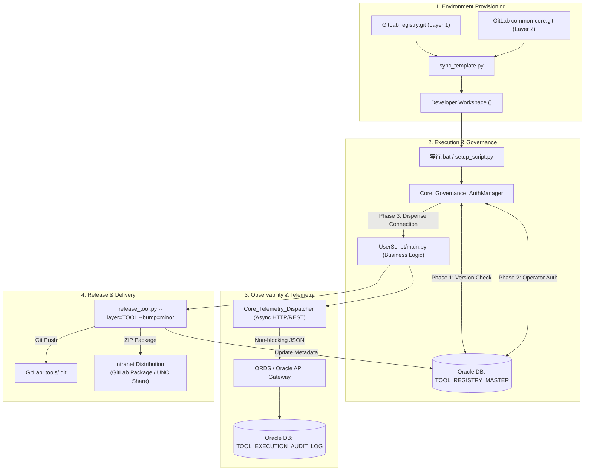

# Enterprise Portable Python Architecture & Governance Specification (GitLab + Oracle DB)

## 1. Objective
Design and document an enterprise-grade, highly portable, AI-assisted development and deployment framework adapted for corporate intranets utilizing **GitLab** for source code hosting and **Oracle Database** (Oracle DB / ORDS) for central tool registry, governance, and audit logging.

This framework enables:
1. **Zero-Pollution Developer Environments**: No administrative privileges required; uses standalone Embeddable Python 3.15 isolated from system Python.
2. **3-Layer Separation of Concerns**: Strict boundary between runtime binaries (`REGISTRY`), shared enterprise core (`COMMON_CORE`), and domain tools (`<TOOL_CODE>`).
3. **Automated Enterprise Governance & Telemetry**: Startup version enforcement, operator identity verification, credential dispensing, audit logging, and save-preserving client auto-updates via Oracle DB.
4. **Seamless CI/CD & End-User Delivery**: Automatic packaging and distribution to internal portals or network shares with user manuals and issue tracker integration.

---

## 2. Sub-goals & Rationale for Selection

| Component | Cloud / Public Stack | Corporate Intranet Candidate | Selected Enterprise Stack | Rationale for Selection |
| :--- | :--- | :--- | :--- | :--- |
| **Source Management** | GitHub Private Repos | Monorepo vs. Multi-Repo in GitLab | **3-Tier Subgroup in GitLab** (`<group>/registry`, `<group>/common-core`, `<group>/<tool-code>`) | Eliminates binary bloat in tool repos; allows fine-grained role-based access control (RBAC) per tool. |
| **Central Governance Registry** | Google Sheets (`ツール管理台帳`) | Confluence Wiki vs. Oracle DB | **Oracle Database (`TOOL_REGISTRY_MASTER` Table)** | ACID compliance, row-level locking, direct PL/SQL stored procedures for audit trails and credential dispensing. |
| **Telemetry & Log Ingestion** | Google Apps Script (GAS) | Logstash / Fluentd vs. Oracle REST Data Services (ORDS) | **ORDS (Oracle REST Data Services) or Lightweight FastAPI Gateway** | Native HTTPS endpoints talking directly to Oracle DB without requiring specialized SIEM agents on client endpoints. |
| **Artifact Distribution** | Google Drive (`Programs/`) | Shared Folder (`SMB/CIFS`) vs. JFrog Artifactory / GitLab Generic Packages | **GitLab Generic Packages & Internal Shared Storage (`\\corp\tools\<TOOL_CODE>`)** | Secure versioned storage accessible across intranet; integrated with GitLab release pipelines. |
| **Client Save & Auto-Update** | GAS Chunks + Google Drive API | Manual reinstall vs. Automated in-place extraction with migration | **`Core_User_Lifecycle_Manager` (Oracle/ORDS-backed)** | Downloads release archives from GitLab/ORDS, protects `.data/save/`, and executes schema migrations seamlessly. |

---

## 3. Task List, Decisions & Rationale

### 3.1 Architecture Overview (3-Layer GitLab Structure)

```text
gitlab.company.corp/
└── ai-automation/                             # GitLab Subgroup
    ├── registry.git                           # Layer 1: Python 3.15 Embeddable Binaries & Skeleton Folders
    ├── common-core.git                        # Layer 2: Enterprise Core Modules, Universal Scripts, Templates
    └── tools/
        ├── tool-game-cloud-mgr.git            # Layer 3: Specific Domain Tool
        └── tool-finance-batch.git             # Layer 3: Specific Domain Tool
```

#### Layer 1: `REGISTRY` (`gitlab.company.corp/ai-automation/registry.git`)
- **Contents**:
  - Pure portable Python runtime (`python.exe`, `pythonw.exe`, `python315.dll`, `python315.zip`, `python315._pth`, stdlib `*.pyd` and `*.dll` files).
  - Standard directory skeleton preserved using `.gitkeep`:
    - `.config/`, `.data/`, `.data/log/`, `.data/temp/`, `.doc/`, `.doc/script/`, `.doc/test/`, `.vscode/`, `.test/`, `UserScript/`, `UserScript/core/`, `UserScript/user/`.
- **Governance**: Read-only for standard developers; updated only by Enterprise Infrastructure Architects when bumping Python patch levels or standard C-runtime libraries.

#### Layer 2: `COMMON_CORE` (`gitlab.company.corp/ai-automation/common-core.git`)
- **Contents**:
  - `UserScript/core/`:
    - `core_governance_auth_manager.py`: Connects to Oracle DB, verifies `tool_version >= min_supported_version`, checks operator credentials, dispenses frozen DB connections.
    - `core_database_handler.py`: Enterprise Oracle DB runner utilizing `oracledb` (Thin/Thick mode) and SQLAlchemy with transaction rollback guards.
    - `core_execution_monitor.py` & `core_telemetry_dispatcher.py`: Fixed 5-char structured logger sending telemetry to Oracle DB audit tables asynchronously.
    - `core_user_lifecycle_manager.py`: First-launch tutorial tracking, Oracle registry update checker, save-preserving in-place updates.
    - `core_file_json_handler.py`, `core_data_io_processor.py`, `core_mail_dispatcher.py`, `core_system_logger.py`.
  - Universal Scripts: `setup_script.py`, `sync_template.py`, `release_tool.py`, `実行.bat`, `開発環境.code-workspace`.
  - Template specifications: `.doc/script/core_*.md`, `.doc/PROJECT_STATUS.md` template, `.config/app_environment.sample.json`.
  - Verification test suite: `.test/test_core_suite.py`.

#### Layer 3: Tool-Specific (`gitlab.company.corp/ai-automation/tools/<TOOL_CODE>.git`)
- **Contents**:
  - Domain business logic: `UserScript/user/` and `UserScript/main.py`.
  - Tool specifications and tests: `.doc/script/user_*.md`, `.doc/PROJECT_STATUS.md`, `tests/`.
  - Tool options: `app_environment.sample.json`, `requirements.txt`, UI assets (`src/`, `templates/`).
  - `.gitignore`: Strictly excludes Layer 1 (`REGISTRY`), Layer 2 (`COMMON_CORE`), and site-packages.

---

### 3.2 Oracle Database Schema Design

#### Table 1: `TOOL_REGISTRY_MASTER` (Central Tool Registry & Governance)
```sql
CREATE TABLE TOOL_REGISTRY_MASTER (
    SEQ_NO                 NUMBER GENERATED BY DEFAULT AS IDENTITY PRIMARY KEY,
    TOOL_CODE              VARCHAR2(64) NOT NULL UNIQUE,
    TOOL_NAME              VARCHAR2(256) NOT NULL,
    CATEGORY               VARCHAR2(64),
    GITLAB_REPO_URL        VARCHAR2(512) NOT NULL,
    CURRENT_VERSION        VARCHAR2(32) NOT NULL,
    MIN_SUPPORTED_VERSION  VARCHAR2(32) NOT NULL,
    STATUS                 VARCHAR2(16) DEFAULT 'ACTIVE' CHECK (STATUS IN ('ACTIVE', 'MAINTENANCE', 'DEPRECATED')),
    AUTH_REQUIRED          NUMBER(1) DEFAULT 0 CHECK (AUTH_REQUIRED IN (0, 1)),
    RELEASE_PACKAGE_URL    VARCHAR2(1024),
    DOCUMENTATION_URL      VARCHAR2(1024),
    FEEDBACK_URL           VARCHAR2(1024),
    TARGET_DB_ALIAS        VARCHAR2(64),
    LAST_UPDATED_AT        TIMESTAMP WITH TIME ZONE DEFAULT CURRENT_TIMESTAMP,
    LAST_UPDATED_BY        VARCHAR2(64)
);

COMMENT ON TABLE TOOL_REGISTRY_MASTER IS 'Central registry for all enterprise AI-assisted tools and governance rules';
```

#### Table 2: `TOOL_EXECUTION_AUDIT_LOG` (Telemetry & Execution Telemetry)
```sql
CREATE TABLE TOOL_EXECUTION_AUDIT_LOG (
    LOG_ID                 NUMBER GENERATED BY DEFAULT AS IDENTITY PRIMARY KEY,
    RUN_ID                 VARCHAR2(64) NOT NULL,
    TOOL_CODE              VARCHAR2(64) NOT NULL,
    TOOL_VERSION           VARCHAR2(32) NOT NULL,
    OPERATOR_USERNAME      VARCHAR2(64),
    HOST_NAME              VARCHAR2(128),
    IP_ADDRESS             VARCHAR2(64),
    EXECUTION_STATUS       VARCHAR2(16) CHECK (EXECUTION_STATUS IN ('STARTED', 'SUCCESS', 'FAILED', 'ALERT')),
    START_TIME             TIMESTAMP WITH TIME ZONE DEFAULT CURRENT_TIMESTAMP,
    END_TIME               TIMESTAMP WITH TIME ZONE,
    ELAPSED_SECONDS        NUMBER(10, 3),
    RECORDS_PROCESSED      NUMBER(12),
    ERROR_MESSAGE          CLOB,
    EXECUTION_PAYLOAD      CLOB,
    CONSTRAINT FK_AUDIT_TOOL FOREIGN KEY (TOOL_CODE) REFERENCES TOOL_REGISTRY_MASTER(TOOL_CODE)
);

CREATE INDEX IDX_AUDIT_RUN_ID ON TOOL_EXECUTION_AUDIT_LOG(RUN_ID);
CREATE INDEX IDX_AUDIT_TOOL_DATE ON TOOL_EXECUTION_AUDIT_LOG(TOOL_CODE, START_TIME);
```

#### Table 3: `TOOL_FEEDBACK_STORE` (End-User Feedback & Bug Reports)
```sql
CREATE TABLE TOOL_FEEDBACK_STORE (
    FEEDBACK_ID            NUMBER GENERATED BY DEFAULT AS IDENTITY PRIMARY KEY,
    TOOL_CODE              VARCHAR2(64) NOT NULL,
    SUBMITTER_NAME         VARCHAR2(128),
    SUBMITTER_EMAIL        VARCHAR2(256),
    CATEGORY               VARCHAR2(32) CHECK (CATEGORY IN ('BUG', 'FEATURE_REQUEST', 'QUESTION', 'OTHER')),
    SUMMARY                VARCHAR2(256) NOT NULL,
    DETAIL_DESCRIPTION     CLOB NOT NULL,
    ATTACHMENT_URL         VARCHAR2(1024),
    STATUS                 VARCHAR2(32) DEFAULT 'NEW' CHECK (STATUS IN ('NEW', 'INVESTIGATING', 'RESOLVED', 'WONT_FIX')),
    CREATED_AT             TIMESTAMP WITH TIME ZONE DEFAULT CURRENT_TIMESTAMP
);
```

---

## 4. Overall Workflow & Architecture

### 4.1 End-to-End Enterprise Lifecycle



### 4.2 Automated 3-Layer Release Sequence (`release_tool.py`)
In the enterprise environment, `release_tool.py` operates as follows:
1. **Layer Classification**:
   - Inspects staging differences.
   - If runtime binaries changed, commits to `registry.git`.
   - If `UserScript/core/` or universal scripts changed, commits to `common-core.git`.
   - Domain code in `UserScript/user/` and configs commit to `tools/<TOOL_CODE>.git`.
2. **Version Bump & Oracle DB Update**:
   - Computes semantic version `x.y.z` (`major` = breaking/new module, `minor` = feature update, `patch` = bugfix).
   - Executes PL/SQL package or REST call to update `TOOL_REGISTRY_MASTER.CURRENT_VERSION`.
3. **End-User Distribution Packaging**:
   - Prompts operator: `Publish release package to Enterprise Distribution Share? [Y/n]`.
   - Bundles clean self-contained runtime archive excluding `.git`, `.data/log`, `.data/save`, and secrets.
   - Pushes artifact to GitLab Generic Package Registry or corporate UNC file share (`\\corp\dfs\tools\<TOOL_CODE>\`).

---

## 5. Review: Strengths & Enterprise Rejection Log

### Strengths
- **Non-Admin Execution**: Portable Python 3.15 runs completely within user-space (`AppData` or `D:\Tools`), circumventing restricted enterprise desktop policies that block standard installers or virtual environments.
- **Enterprise Traceability**: Every execution logs machine hostname, Windows login user, IP address, and execution duration directly into Oracle DB, satisfying SOC2/ISO27001 audit compliance.
- **Save Data Protection**: When end-users update client tools, user databases and preferences in `.data/save/` are automatically backed up and migrated into the new package without risk of data loss.

### Trialed & Rejected Approaches
| Trialed Approach | Rejection Reason |
| :--- | :--- |
| **Direct Monorepo in GitLab** | Committing runtime binaries (`.exe`, `.dll`, `python315.zip`) into every project repository causes repository bloat and slows down git operations over VPN. Splitting into `registry.git` and `common-core.git` solved this. |
| **Python Virtual Environments (`.venv`)** | Fragile across network drives and requires symlinks/privileges often disabled on enterprise Windows machines. Embeddable Python with localized `site-packages` is completely relocatable. |
| **Storing Large Release ZIPs in Oracle BLOBs** | Heavy strain on Oracle SGA buffer cache and backup window size. Rejected in favor of keeping release ZIPs on network shares / GitLab Package Registry, with metadata only stored in Oracle DB. |

---

## 6. Operational Notes & Constraints

1. **Oracle Client Libraries**:
   - Python 3.15 utilizes `python-oracledb` in **Thin mode** by default, which does not require Oracle Instant Client libraries or `TNS_ADMIN` installation on client machines.
   - If Advanced Security (Native Encryption / Radius authentication) is required, place the 64-bit Oracle Instant Client Basic DLLs inside `EmbeddablePython/` and initialize Thick mode via `oracledb.init_oracle_client()`.
2. **Strict Coding & File Naming**:
   - In accordance with enterprise governance, Japanese proper nouns (system names, sheet titles, table names) are preserved verbatim, while all technical code, variables, and comments remain in English.
   - No half-width parentheses in Python comments or docstrings (`（）` or `［］` only).
